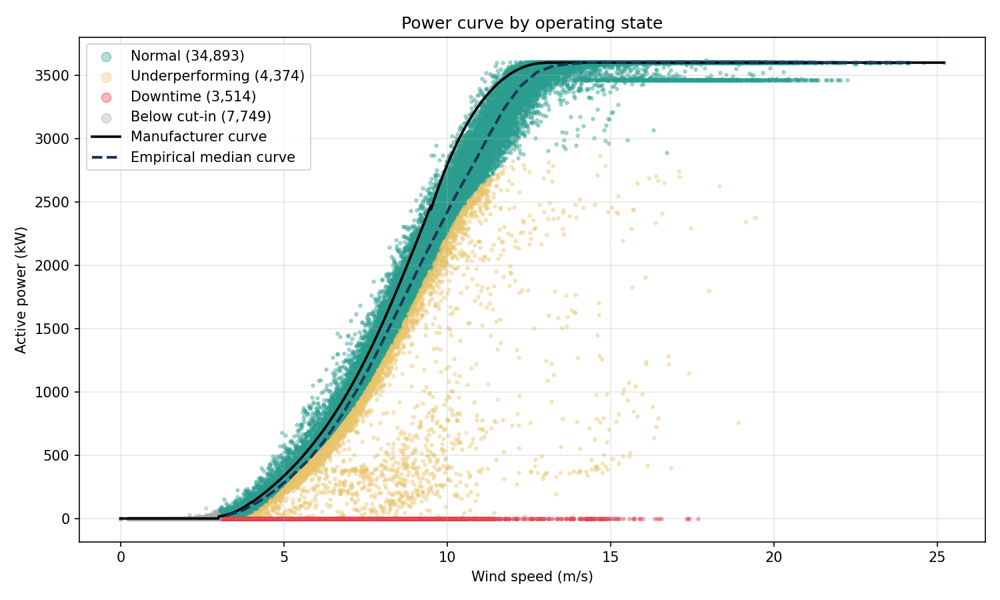

# Wind Turbine SCADA Analysis: Power-Curve Performance and Anomaly Detection

Analysis of one year of 10-minute SCADA data from a single wind turbine: data-quality audit,
operating-state classification, energy-loss estimation against the manufacturer power curve,
anomaly detection, and a baseline power model.



## Data

Public Kaggle dataset **"Wind Turbine Scada Dataset"** (`T1.csv`): one turbine, 2018, 10-minute
resolution, 50,530 rows. Columns: active power, wind speed, theoretical (manufacturer) power curve,
wind direction. Please check the dataset's page on Kaggle for its licence and attribution.

## Method

| Step | Module | What it does |
|---|---|---|
| Audit | `src/audit.py` | Missing values, duplicates, time gaps, ranges |
| Features | `src/features.py` | Residual vs theoretical curve, energy loss, wind-direction encoding, operating state |
| Analysis | `src/analysis.py` | Empirical power curve, monthly loss, Isolation Forest, gradient-boosting power model |
| Plots | `src/plots.py` | Figures saved to `figures/` |

Operating states (rule-based, thresholds in `src/features.py`):

- **Below cut-in**: wind speed < 3 m/s
- **Downtime**: wind speed >= 3 m/s but power <= 0
- **Underperforming**: power more than 20% (and at least 100 kW) below the theoretical curve
- **Normal**: everything else

## Results

| Quantity | Value |
|---|---|
| Energy at theoretical curve | 12,567 MWh |
| Energy measured | 11,013 MWh (about 12% lower) |
| Samples in downtime | 3,514 (7.0%), about 462 MWh lost |
| Samples underperforming | 4,374 (8.7%), about 408 MWh lost |
| Isolation Forest anomalies flagged (2% contamination) | 855 |

Observations:

- The empirical median curve sits to the right of the manufacturer curve between roughly 6 and 12 m/s:
  the turbine produces less than its nominal curve over the steep part of the curve.
- A flat band near 3,460 kW (541 samples above 14 m/s) suggests a derated or power-limited
  operating mode; it is worth investigating separately.
- Downtime is concentrated just above cut-in (median wind speed 4.1 m/s), which is typical of
  start-up/stop cycling, but a quarter of events occur above 7.4 m/s, up to 17.7 m/s.

### Power model vs manufacturer curve

Chronological 80/20 split (test set starts 2018-10-18), scored on every test sample:

| Model | MAE (kW) | RMSE (kW) |
|---|---|---|
| Manufacturer theoretical curve | 207.9 | 470.7 |
| Gradient boosting (wind speed, direction, hour) | 220.4 | 503.6 |

The fitted model does **not** beat the manufacturer curve. Wind speed alone explains most of the
variance, and downtime samples (about 9% of the test set) are unpredictable from these features.
Predicting downtime would need extra signals (e.g. temperatures, pitch, alarms) that this dataset does not include.

## Limitations

- One turbine, one year: seasonal effects cannot be separated from a single year and the
  results do not generalise to other turbines.
- The rule-based thresholds are judgement calls. The "underperforming" label also catches the
  lower edge of the normal scatter; the 20% / 100 kW thresholds should be tuned or validated
  against maintenance logs, which are not available.
- 32 time gaps (about 2,030 missing 10-minute samples) are left as they are, not interpolated.
- The theoretical curve is used as a reference only; the dataset labels it "KWh" but it is treated as kW.
- Isolation Forest flags statistical outliers in (wind speed, power) space, not confirmed faults.

## Reproduce

```bash
python -m venv .venv
.venv\Scripts\activate        # Linux/macOS: source .venv/bin/activate
pip install -r requirements.txt
python run_analysis.py
```

Outputs: figures in `figures/`, metrics in `results/summary.json`.

## Project structure

```
wind-turbine-scada-analysis/
  data/T1.csv
  src/            audit.py  data.py  features.py  analysis.py  plots.py
  figures/        generated plots
  results/        summary.json
  run_analysis.py entry point
```

## Possible next steps

- Fit a per-direction or per-season power curve, or use IEC 61400-12 binning with air-density correction.
- Detect the high-wind power-limited band explicitly and quantify its energy cost.
- Time-series anomaly detection on the residual (rolling statistics, change-point detection).
- Test on additional turbines or datasets to check how well the findings generalise.
